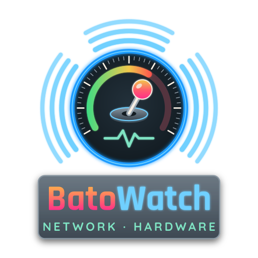

<p align="center"></p>

# 📈 BatoWatch

BatoWatch keeps an eye on your Batocera box: **how its hardware is doing** (temperatures, load, memory, power, disks) and **who is connected to it** (Moonlight streams, devices on your network and over Tailscale). It keeps a history, warns you on screen when something is wrong, and shows it all on a web dashboard and on your TV.

x86_64 (PC) Batocera. ARM devices will follow. See [CHANGELOG.md](CHANGELOG.md) for what's new.

---

## 🚀 Installing

From a terminal on the box (over SSH, or *F1 → Applications → xterm*):

```sh
curl -L https://raw.githubusercontent.com/jimmyayoade/batowatch/main/install.sh | bash
```

When it's done, it tells you where to find everything. Running it again updates BatoWatch and keeps your settings and history.

### Choosing a version

Every release is tagged (`v1.0.0`, `v1.1.0`, …) and listed on the [Releases](https://github.com/jimmyayoade/batowatch/releases) page with what changed. The installer installs the newest one. To install a different one, name it:

```sh
curl -L https://raw.githubusercontent.com/jimmyayoade/batowatch/main/install.sh | BATOWATCH_VERSION=1.1.0 bash
```

Going back to an older version keeps your settings and history. Releases before 1.2.0 have no packet counter (`bw-flows`), so their Network tab needs the kernel's connection tracking, which Batocera 43 doesn't have.

## 🖥️ The dashboard (phone, tablet or computer)

Open a browser on any device on your network and go to the address the installer showed, for example:

```
192.168.1.50:8686
```

(use your box's address; over Tailscale, its Tailscale address works too).

- **The first time, your browser warns that the connection isn't private.** That's expected: BatoWatch made its own certificate, because no outside company signs certificates for home devices. Choose *Advanced → Continue*. The browser remembers, so it asks once per address.
- **Log in with user `root` and your Batocera password**, the one set in *EmulationStation → System settings → Security*. If you never set one, it's `linux`. If you change it later, the new one works straight away.

The dashboard has three tabs:

| Tab | What's on it |
|-----|--------------|
| **Hardware** | Gauges for CPU, temperature, memory, power, GPU and the hottest drive; a card for each part; graphs over 1 hour to 1 year (shaded while a game was running); past alerts |
| **Network** | Who is streaming with Moonlight right now, every connected device, and what connected or left recently |
| **Settings** | Every setting, explained, with your current value and the default |

Use **Customize** on the Hardware tab to reorder or hide gauges and cards. That's saved in your browser, so your phone and computer can differ.

## 📺 On the TV

Open **Ports → BatoWatch**. The first time, it asks you to hold each button so it learns your controller (if you already did this in the BUA app, it reuses that).

| Controller | Keyboard | Does |
|------------|----------|------|
| D-pad / left stick | Arrow keys | Move |
| A | Enter | Open a section |
| B | Backspace | Back |
| LB / RB | Shift+Tab / Tab | Switch between Hardware and Network |
| X / Y | [ / ] | Zoom the graphs in and out (1 hour … 1 year) |
| Start | Space | Settings: size of everything, controller layout, button setup |
| Back (Select) | R | Refresh |
| Hotkey + Start | Esc | Exit |

The hints at the bottom of the screen show controller buttons, or keyboard keys when no controller is plugged in.

## 🔔 On-screen messages

BatoWatch shows a short banner over whatever is on screen, even in a game:

- **SUNSHINE**: someone connected with Moonlight. *"test-pc has connected"*
- **UNKNOWN DEVICE**: a device BatoWatch doesn't know connected to the box. *"192.168.1.50 on SSH"* (see below)
- **NOTICE**: something needs attention. It only appears for real problems:

| Message | When |
|---------|------|
| CPU / GPU too hot | It reaches its safe limit (the chip's own limit, or 90 °C) |
| Disk too hot | It reaches the drive's own limit, or 70 °C |
| Disk almost full | Less than 5 GB, or less than 2%, is left |
| Disk failing | The drive's own health check reports a problem |
| RAM almost full | Less than 5% of the memory is free |

A problem has to last 30 seconds before it shows (disk space and health: right away), and the same message repeats at most every 30 minutes. Every alert is also listed on the dashboard.

The gauges help you see it coming: **mint** is normal, **amber** means getting close to a limit, **red** means the limit is reached. A busy CPU stays mint: games are supposed to use it.

### Unknown devices

BatoWatch tells you when a device it doesn't know connects to the box: a red **UNKNOWN DEVICE** banner, a red line in the dashboard's Activity list (tap it to go to the device), and a line in the log.

- **Known devices** are the ones in `aliases.conf`, plus your own Tailscale machines, which are always known. Connections the box makes itself (to the internet, for example) never count.
- **Mark as known**: on the dashboard, open the device in the Network tab, give it a name and press *Mark as known*. On the TV, open the device and press **X**: it keeps its current name, which you can change on the dashboard. Either way it's saved in `aliases.conf`, by MAC address for a device on your home network, so a new IP from your router doesn't make it unknown again.
- **Forget** takes a device out of `aliases.conf` again. The dashboard's Settings tab lists every known device, to rename, remove or add one before it ever connects.
- **The first time** alerts are on, BatoWatch adds the home-network devices already in its history to `aliases.conf` under their current names, so you don't get an alert for each of your own devices. It says how many in the log. Rename or remove any of them.
- After a restart it waits 20 seconds before alerting, because a device that was already connected can take a few seconds to show up.
- The same device alerts at most once an hour.

| Setting | Default | What it does |
|---------|---------|--------------|
| `ALERT_UNKNOWN` | `on` | Turns the alert on or off |
| `ALERT_ATTEMPTS` | `off` | `on` also alerts when an unknown device tries a port nothing is listening on (port scans; phones and smart TVs do this too) |
| `KNOWN_DEVICES` | `named` | `named`: only `aliases.conf` and your Tailscale machines. `seen`: also every device in BatoWatch's history |
| `NOTIFY` | `overlay` | Where banners show: `overlay` (over games), `es` (EmulationStation pop-up), `both`, or `print` (log only) |

## ⚙️ Settings

Change them on the dashboard's **Settings** tab, or in the file:

```
/userdata/system/add-ons/batowatch/batowatch.conf
```

Both are the same settings; most apply within seconds. Some you may want:

| Setting | Default | What it does |
|---------|---------|--------------|
| `TEMP_UNIT` | `TZ` | `C`, `F`, or `TZ` (°F for US time zones, °C elsewhere) |
| `LOGIN` | `batocera` | `batocera` (root + your Batocera password), `user:password`, or `none` |
| `DEFAULT_TAB` | `hardware` | The tab the dashboard opens on |
| `OVERLAY_SCALE` | `1.1` | Size of the on-screen messages |
| `OVERLAY_ACCENT`, `OVERLAY_FG`, … | | Colours of the on-screen messages |
| `CONNECT_REPEAT` | `10` | Seconds before the same device gets a "connected" message again (`0` = always) |
| `ALERT_CPU_TEMP`, `ALERT_RAM`, … | | Alert limits; `0` turns one off |
| `WEB_BIND` | `0.0.0.0` | Set your Tailscale address (100.x.y.z) to keep the dashboard off your home network |

Device names: give your devices friendly names in `aliases.conf` in the same folder (instructions inside). It's also the list of known devices (see *Unknown devices* above).

## 🕓 History

BatoWatch keeps every reading for 24 hours, minute averages for 7 days, and hour averages for a year. The history stays the same size (a few MB) and is written to disk every few minutes, which is gentle on SD cards and SSDs.

## 🗑️ Uninstalling

From a terminal on the box:

```sh
/userdata/system/add-ons/batowatch/uninstall.sh
```

It asks **"Keep BatoWatch's history?"**:

- **Yes** keeps it in `/userdata/system/batowatch_history`, and installing BatoWatch again picks it up.
- **No** deletes it.

With no screen to ask on (for example `ssh` without `-t`), it keeps the history. `uninstall.sh --ignore-warning` removes everything without asking, history included.

Versions before 1.2.0 don't put `uninstall.sh` on the box. For those, download it:

```sh
curl -L https://raw.githubusercontent.com/jimmyayoade/batowatch/main/uninstall.sh | bash
```

## 🔒 Privacy and safety

- The dashboard shows every device on your network that talks to the box. **Never open its port (8686) to the internet.** Use Tailscale to see it from outside your home.
- The login uses your Batocera password, which BatoWatch reads when it starts and keeps only in memory. Browsers prove they know it without sending it.
- BatoWatch only watches. To see who's connected and how much they send, it runs a small packet counter (`bw-flows`) that keeps only the first 128 bytes of each packet and reads only the addresses and ports from them. Without it, BatoWatch switches on the kernel's connection counters instead, as NetWatch did. It never changes your network or your other settings.

## 💡 What BatoWatch costs

On a ThinkCentre M710q (Intel i5-6500T): about 1% of one CPU core, about 36 MB of memory, and no measurable effect on games (same frame rate with and without BatoWatch).

## 🛠️ Troubleshooting

| Problem | Try |
|---------|-----|
| The dashboard doesn't open | Check the address and port (`8686`). Typing it without `https://` works. |
| The login is refused | Use user `root` and the password from *EmulationStation → System settings → Security* (`linux` if never set). |
| "The dashboard is locked" | BatoWatch couldn't read your Batocera password. Set `LOGIN=user:password` in `batowatch.conf`. |
| A part is missing | Open *Not available on this device* at the bottom of the Hardware tab: it says why (e.g. *Disk health needs Batocera 33 or newer*). |
| No on-screen messages | Set `NOTIFY=es` to use EmulationStation's own pop-ups instead. |

Logs: `/userdata/system/logs/batowatch.log`

## 🧑‍💻 Development

BatoWatch is plain Python 3 (standard library only) plus one HTML page; the TV app uses pygame, which Batocera ships.

| Path | What |
|------|------|
| `batowatch.py` | The service: network tracking, hardware sampling, alerts, banners, the web server |
| `hardware.py`, `history.py`, `alerts.py` | Hardware sources, the history database, alert rules |
| `settings.py`, `webauth.py`, `tls.py` | Settings file, login, HTTPS certificates |
| `known.py` | Known devices: reads and edits `aliases.conf` |
| `www/dashboard.html` | The web dashboard |
| `tv/batowatch_tv.py` | The TV app (pygame) |
| `batowatch-service.sh` | The Batocera service script |
| `install.sh`, `uninstall.sh` | The installer (downloads a release) and the uninstaller |
| `flows/` | `bw-flows`, the packet counter (C, built static for x86_64 and aarch64 by CI and attached to each release), and `build.sh` to build it locally with Docker |
| `art/` | Logo sources and the scripts that make the icons and the loading animation |
| `tests/` | Tests that run anywhere (fake `/sys` trees, settings, login, known devices) |

Run the tests: `python3 tests/test_fake_trees.py && python3 tests/test_settings_auth.py && python3 tests/test_known.py`. They also run on every push.

### Making a release

1. Set `VERSION` in `batowatch.py` (versions follow [semantic versioning](https://semver.org): bug fixes raise the last number, new features the middle one).
2. Add a section for it at the top of `CHANGELOG.md`.
3. Commit, then tag and push: `git tag v1.1.0 && git push && git push --tags`.

The release workflow checks that the tag matches `VERSION`, runs the tests, builds `bw-flows` for both architectures and publishes the release with its changelog section, the two binaries and their `SHA256SUMS`. The installer installs it from then on.

## 📄 License

GPL-3.0, see [LICENSE](LICENSE). BatoWatch grew out of NetWatch, written by the same author for BUA, which is also GPL-3.0.
